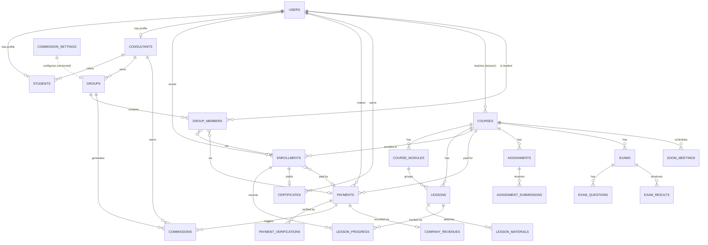

# ETEC — Database Schema & ER Diagram

MySQL 8, `utf8mb4_unicode_ci`. 30+ normalized tables with foreign keys and
indexes. Money columns are `DECIMAL`. Audit trail via `activity_log`
(spatie/laravel-activitylog).

## Entity–Relationship Diagram

## Table reference

### Identity & access
| Table | Notes |
|-------|-------|
| `users` | +phone, avatar, theme, status, 2FA, last_login, soft deletes |
| `password_reset_tokens`, `sessions` | Laravel defaults |
| `roles`, `permissions`, `model_has_roles`, `model_has_permissions`, `role_has_permissions` | Spatie |
| `personal_access_tokens` | Sanctum |

### Profiles
| Table | Key FKs |
|-------|---------|
| `students` | user_id, consultant_id, group_id |
| `consultants` | user_id, approved_by; totals; referral_code |

### Courses / LMS
| Table | Key FKs |
|-------|---------|
| `courses` | lecturer_id → users |
| `course_modules` | course_id |
| `lessons` | course_id, module_id |
| `lesson_materials` | lesson_id |
| `enrollments` | user_id, course_id, payment_id · UNIQUE(user,course) |
| `lesson_progress` | enrollment_id, lesson_id · UNIQUE pair |
| `assignments` / `assignment_submissions` | course/lesson/lecturer · student, graded_by |
| `exams` / `exam_questions` / `exam_results` | course/lecturer · exam · student |
| `certificates` | user_id, course_id, enrollment_id · UNIQUE(user,course) |
| `zoom_meetings` | course_id, lesson_id, lecturer_id |

### Finance & commission
| Table | Key FKs |
|-------|---------|
| `payments` | user_id, course_id, consultant_id, group_id · status pending→verified |
| `payment_verifications` | payment_id, verified_by |
| `commission_settings` | versioned config (price, tiers, group size) |
| `groups` | consultant_id · capacity/filled_slots · open→completed→closed |
| `group_members` | group_id, user_id, enrollment_id, payment_id · UNIQUE(group,user) & (group,position) |
| `commissions` | consultant_id, group_id, group_member_id, user_id, payment_id · tier, status |
| `company_revenues` | payment_id, course_id · overflow & full revenue |

### CMS & system
| Table | Notes |
|-------|-------|
| `blogs` | author_id, slug, tags(json), soft deletes |
| `testimonials`, `faqs`, `contact_messages`, `pages` | public site content |
| `settings` | key/value/type/group cached config |
| `activity_log` | audit trail |
| `jobs`, `job_batches`, `failed_jobs`, `cache`, `cache_locks` | queue/cache infra |

## Circular-FK handling
Two pointer columns intentionally omit a DB-level foreign key to avoid
create-order cycles (both are indexed and enforced in application code):
- `consultants.active_group_id` → groups (group is created after the consultant)
- `payments.enrollment_id` → enrollments (enrollment is created after the payment)
